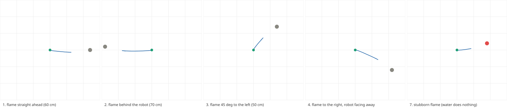
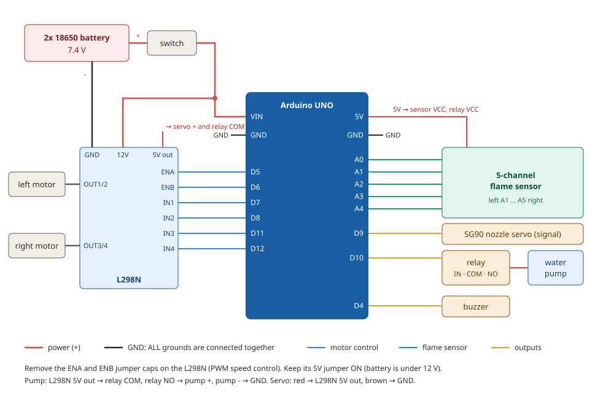

# Autonomous Fire-Fighting Robot (Arduino)

A small two-wheeled robot that **finds a flame by itself, drives to it and puts it out with water**.
It runs on an Arduino UNO with a 5-channel infrared flame sensor, a water pump switched by a relay,
and a servo that sweeps the nozzle across the flame.

> **Status:** firmware written and verified in a PC simulation (7/7 scenarios pass).
> Hardware build in progress.


*Simulation: the robot (green dot = start, blue = path) finds and extinguishes a candle (grey = put out)
placed ahead, behind, to the left and to the right. In the last case the "flame" cannot be put out,
so the robot stops and raises an alarm after 4 attempts.*

---

## How it works

The robot is a **state machine**: at every moment it is in exactly one state, and sensor readings
decide when it moves to the next one.

```
STARTING -> SEARCH -> APPROACH -> EXTINGUISH -> CHECK --(fire out)--> BACK_OFF -> SEARCH
               ^          ^                       |
               |          +---- still burning ----+
               +------------ flame lost ----------+        too many attempts -> ALARM
```

| State | What the robot does | Leaves when |
|---|---|---|
| `STARTING` | waits 3 s, then measures the room's IR light with no fire (calibration) | calibration done |
| `SEARCH` | turns on the spot in small steps, looking for infrared light | a channel sees a flame |
| `APPROACH` | steers towards the flame using the 5 channels (turns, curves or drives straight) | flame is close (~20 cm) or lost |
| `EXTINGUISH` | stops, switches the pump on, sweeps the nozzle left/right for 2.5 s | spray time over |
| `CHECK` | pump off, waits 1.2 s for flicker/smoke to settle, looks again | fire out / still burning |
| `BACK_OFF` | reverses away from the candle, beeps | 0.5 s later |
| `ALARM` | could not put the fire out after 4 sprays: stops everything and beeps | reset by a human |

**Finding the direction.** Each of the 5 channels points in a different direction (left to right).
The firmware computes a weighted average of their readings: `-2` means the flame is far left,
`0` straight ahead, `+2` far right. That single number decides how the robot steers.

**Adapting to the room.** At start-up the robot records what every channel reads *without* a flame
(the baseline). Afterwards it only reacts to changes from that baseline, so normal room light does
not trigger it.

**Safety features.** The pump can never run longer than 4 s in one go, the relay is set to OFF
before its pin is enabled (no squirt at power-up), and the robot gives up and alarms instead of
spraying forever.

---

## Hardware

| Part | Purpose |
|---|---|
| Arduino UNO R3 | controller |
| 2WD robot chassis (2 TT gear motors, wheels, caster) | body and movement |
| L298N motor driver | powers the motors from the battery, controlled by the Arduino |
| 5-channel IR flame sensor | sees flames in 5 directions |
| Mini submersible pump (3-5 V) + tube | sprays water |
| 1-channel 5 V relay module | lets the Arduino switch the pump |
| SG90 servo | sweeps the nozzle |
| Active buzzer | status sounds |
| 2x 18650 Li-ion cells + holder with switch | 7.4 V power |
| Small plastic bottle, jumper wires, zip ties | water tank, wiring, mounting |

Total cost of the electronics: about **US $21** (+ batteries).

### Wiring



Full pin table and power notes: [docs/wiring.md](docs/wiring.md).

---

## Repository layout

```
firmware/
  fire_fighting_robot/     main program (open this folder in the Arduino IDE)
    fire_fighting_robot.ino   state machine and robot logic
    config.h                  all pins, thresholds, speeds and timings
  tests/                   one small sketch per part, for checking the hardware step by step
    01_motor_test/  02_flame_sensor_test/  03_pump_relay_test/  04_servo_test/
sim/                       PC simulator that runs the real firmware against a virtual robot
docs/                      wiring, report, images
```

## Building it

1. **Wire one part at a time** and run its test sketch from `firmware/tests/` (motors, flame sensor,
   pump, servo). Each test prints what *should* happen on the Serial Monitor (9600 baud).
2. If something is reversed (wheel direction, sensor order, relay logic), **change the matching flag
   in `config.h`** rather than rewiring.
3. Upload `firmware/fire_fighting_robot`, put the robot down with **no flame in view**, wait for the
   beep (calibration), then light a candle in front of it.
4. Tune `FLAME_DETECT_STRENGTH` / `FLAME_NEAR_STRENGTH` in `config.h` using the values printed on
   the Serial Monitor.

With `arduino-cli`:

```bash
arduino-cli core install arduino:avr
arduino-cli lib install Servo
arduino-cli compile --fqbn arduino:avr:uno firmware/fire_fighting_robot
arduino-cli upload  --fqbn arduino:avr:uno -p /dev/ttyUSB0 firmware/fire_fighting_robot
arduino-cli monitor -p /dev/ttyUSB0 -c baudrate=9600
```

## Simulation

`sim/` compiles the **unchanged firmware** for a PC, replacing the Arduino hardware with a simple
2-D world: wheel speeds come from the motor pins, flame-sensor readings come from the distance and
angle to a virtual candle (with noise and flicker), and the candle goes out after enough water hits
it from the nozzle.

```bash
make -C sim          # runs all scenarios, draws paths into sim/out/
./sim/robot_sim 2    # one scenario with the robot's Serial output
```

```
PASS  1. flame straight ahead (60 cm)             put out after 4.54 s, closest 21 cm
PASS  2. flame behind the robot (70 cm)           put out after 7.49 s, closest 19 cm
PASS  3. flame 45 deg to the left (50 cm)         put out after 7.49 s, closest 19 cm
PASS  4. flame to the right, robot facing away    put out after 5.73 s, closest 18 cm
PASS  5. no flame at all                          never sprayed
PASS  6. flame too far to see (2 m)               never sprayed
PASS  7. stubborn flame (water does nothing)      gave up after 4 sprays and raised the alarm
```

The simulator checks logic, not physics: real sensor values, motor speeds and spray range must be
measured on the hardware and tuned in `config.h`.

### Interactive version in the browser (Wokwi)

`sim/wokwi/` runs the same firmware on a simulated Arduino UNO in [Wokwi](https://wokwi.com). Five
sliders stand in for the flame sensor, and LEDs show what each wheel and the pump are doing. See
[sim/wokwi/README.md](sim/wokwi/README.md).

## Safety

Tests use a single candle on a metal tray, away from anything that can burn, with a glass of water
nearby. Disconnect the battery before changing any wire, and never leave Li-ion cells charging
unattended.

## Future work

- **Drone version.** The "fire-fighting module" (flame sensor + pump + nozzle + controller) is
  independent from the wheels. On a drone, a standard flight controller would handle flying while
  the Arduino keeps the same job: detect, aim, spray. The main challenges are payload weight
  (water is heavy) and local drone regulations.
- Thermal camera instead of IR photodiodes, for longer range and fewer false alarms.
- Ultrasonic sensor to measure the distance to the flame directly.
- Bluetooth status reports to a phone.

See the full write-up in [docs/REPORT.md](docs/REPORT.md).

## License

[MIT](LICENSE): you are free to use, change and share this project, as long as you keep the license notice.
