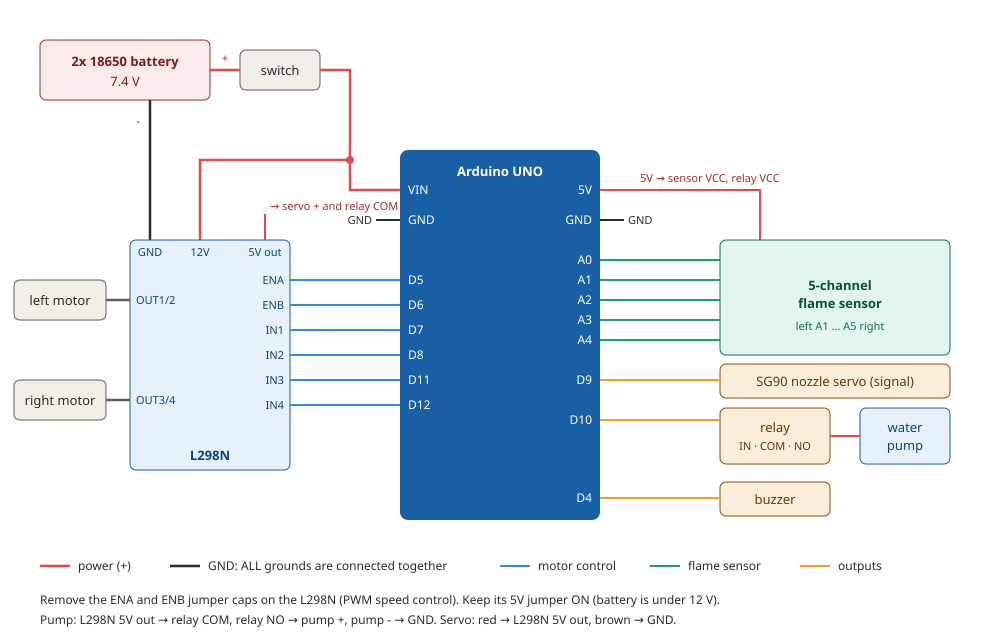

# Wiring



**Golden rule: every GND is connected together** (battery -, L298N GND, Arduino GND, sensor GND,
relay GND, servo brown wire, pump -, buzzer -). Without a common ground nothing works reliably.

Always disconnect the battery before changing a wire.

## Pin table

| Arduino pin | Goes to | Notes |
|---|---|---|
| A0 | flame sensor A1 (leftmost channel) | |
| A1 | flame sensor A2 | |
| A2 | flame sensor A3 (centre) | |
| A3 | flame sensor A4 | |
| A4 | flame sensor A5 (rightmost channel) | the module's D0 pin is not used |
| D4 | buzzer + (or I/O of a 3-pin buzzer module) | |
| D5 | L298N ENA | **remove the ENA jumper cap** |
| D6 | L298N ENB | **remove the ENB jumper cap** |
| D7, D8 | L298N IN1, IN2 | left motor direction |
| D9 | servo signal (orange wire) | |
| D10 | relay IN | |
| D11, D12 | L298N IN3, IN4 | right motor direction |
| 5V | flame sensor VCC, relay VCC, buzzer module VCC | low-current parts only |
| VIN | battery + (after the switch) | 7.4 V, Arduino's regulator makes 5 V |
| GND | common ground | |
| D0, D1 | (free) | used by USB, leave empty |
| D2, D3 | (free) | reserved for Bluetooth later |

## Power

```
battery + --> switch --+--> L298N 12V terminal
                       +--> Arduino VIN
battery - -------------+--> L298N GND --> Arduino GND (common ground)

L298N 5V terminal (output, 5V jumper ON) --+--> servo red wire
                                           +--> relay COM --(NO)--> pump + ;  pump - --> GND
L298N OUT1/OUT2 --> left motor     L298N OUT3/OUT4 --> right motor
```

- The servo and the pump take the most current, so they are powered from the L298N's own 5 V
  regulator, not from the Arduino.
- If the Arduino resets (status messages start again from the beginning) when the pump or the
  servo starts, the 5 V supply is too weak: add an **LM2596 buck converter** set to 5 V for the
  servo and the pump (about US $1).
- It is fine to keep the USB cable plugged in while the battery is connected.

## Checking each part

| Step | Sketch | What you should see |
|---|---|---|
| 1 | `firmware/tests/01_motor_test` | each wheel turns as the Serial Monitor says |
| 2 | `firmware/tests/02_flame_sensor_test` | moving a candle left to right moves the strongest channel 0 to 4 |
| 3 | `firmware/tests/03_pump_relay_test` | pump on 1 s / off 3 s (over a sink!) |
| 4 | `firmware/tests/04_servo_test` | servo centres, then sweeps |

If something is reversed, change the matching setting in `firmware/fire_fighting_robot/config.h`:
`LEFT_MOTOR_REVERSED`, `RIGHT_MOTOR_REVERSED`, `FLAME_PINS` order, `FLAME_LOWER_MEANS_MORE`,
`RELAY_ACTIVE_LOW`.
